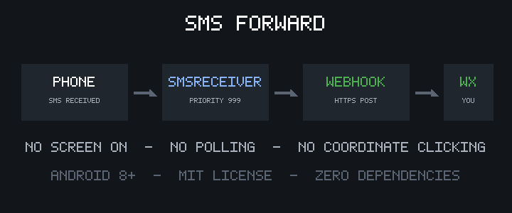

# 短信转发

把安卓手机上收到的短信**实时转发到企业微信**，让你在电脑/另一台设备上第一时间看到验证码。

手机设为静音、不打扰，但该收到的短信一条不落地送到微信。

<p align="center">
  
</p>

---

## 为什么需要它

- **验证码在手机上，人不在手机旁边** —— 短信转发到微信，电脑上直接看
- **手机要静音免打扰**（开会、睡觉、放兜里），但不能漏掉重要短信
- **不想装一堆自动化 App** —— 这个只有一个 APK，零依赖，不联网（只在你配置的服务端发一次请求）

## 特性

| | |
|---|---|
| **息屏可用** | 纯 HTTP 通道，手机完全息屏（Dozing）也能转发，不点亮屏幕 |
| **零误发** | 不做 UI 自动化，不模拟点击，不依赖坐标 |
| **永久有效** | 企业微信群机器人 Webhook 不过期，不需要反复授权 |
| **真·即时** | 短信广播直接触发，无轮询延迟 |
| **保活** | 前台服务 + 开机自启 + 电池优化白名单 + Alarm 兜底 |
| **极简依赖** | 无第三方 SDK，纯 Java + 系统 API |

## 工作原理

```
手机收到短信
    │
    ├─ 1. SmsReceiver 监听 SMS_RECEIVED 广播（priority 999）
    │      → 解析出 发件人 + 正文
    │
    └─ 2. HTTP POST 到企业微信群机器人 Webhook
           msgtype=text（markdown 不行，企微推送到微信会报「暂不支持此消息类型」）
                │
                └─ 你在微信 / 企业微信里看到
```

手机全程无需解锁、无需亮屏。

## 快速开始

### 1. 获取 Webhook

企业微信里建一个**内部群**：

> 群聊右上角「⋯」→ **群机器人** → **添加机器人** → **新建一个机器人**

安全建议三项都不勾（IP 白名单 / 关键词 / 加签），否则客户端请求会被拒。

创建后点「复制地址」，得到：

```
https://qyapi.weixin.qq.com/cgi-bin/webhook/send?key=xxxxxxxx-xxxx-xxxx-xxxx-xxxxxxxxxxxx
```

> ⚠️ 必须是**群机器人（Webhook 模式）**。
> 「智能机器人 / Bot 模式」没有 Webhook 地址，也不支持主动推送消息。

### 2. 构建

无需 Android Studio，无需 Gradle：

```bash
# 下载构建工具链（约 120MB，只需一次）
bash setup-sdk.sh

# 生成签名密钥（首次）
keytool -genkeypair -v -keystore debug.keystore -alias smsfwd \
        -keyalg RSA -keysize 2048 -validity 10000 \
        -storepass android -keypass android \
        -dname "CN=SmsFwd, OU=Dev, O=Local, L=SH, ST=SH, C=CN"

# 构建
bash build.sh
```

产物在 `build/apk/smsfwd.apk`。

> 环境要求：JDK 11+（含 `javac` / `keytool`）、`curl`、`unzip`、`python3`。

### 3. 安装与配置

```bash
adb install -r build/apk/smsfwd.apk

# 授予接收短信权限
adb shell pm grant com.smsfwd.app android.permission.RECEIVE_SMS

# 开启无障碍服务（仅微信 UI 模式需要，Webhook 模式可跳过）
adb shell settings put secure enabled_accessibility_services com.smsfwd.app/.WxAutoService
adb shell settings put secure accessibility_enabled 1

# 加入电池优化白名单，避免被 Doze 杀掉
adb shell cmd deviceidle whitelist +com.smsfwd.app
```

然后打开手机上的「短信转发」应用，填入 Webhook 地址 → 保存 → 点「发送测试消息」验证。

### 4. 让手机静音

```bash
# 铃声静音 + 勿扰模式「仅闹钟」
adb shell cmd notification set_dnd alarms

# 关闭充电常亮、缩短屏幕超时
adb shell settings put global stay_on_while_plugged_in 0
adb shell settings put system screen_off_timeout 15000
```

## 命令行配置

不想开应用界面，可以用广播直接配置：

```bash
# 设置 Webhook 与模式
adb shell am start -n com.smsfwd.app/.MainActivity \
  --es cmd set --es mode hook \
  --es webhook 'https://qyapi.weixin.qq.com/cgi-bin/webhook/send?key=xxx'

# 模拟一条短信（测试用，走完全相同的处理路径）
adb shell am broadcast -n com.smsfwd.app/.ConfigReceiver \
  -a com.smsfwd.app.SIMULATE --es sender 10086 --es text '验证码 123456'

# 触发一次真实转发
adb shell am start -n com.smsfwd.app/.MainActivity \
  --es cmd test --es target <联系人昵称>
```

## 三种转发模式

| 模式 | 说明 | 息屏可靠性 |
|---|---|---|
| `hook` | 企业微信群机器人 Webhook（**推荐**） | ⭐⭐⭐ 完全可靠 |
| `wx` | 微信 UI 自动化：模拟点击把短信发给指定好友 | ⭐ 依赖坐标，微信改版可能失效 |
| `both` | 两者同时 | ⭐⭐⭐ |

`hook` 模式不需要无障碍服务，也不会点亮屏幕。

## 常见问题

**Q：微信里收到的消息显示「暂不支持此消息类型」？**
A：用了 markdown。企微推到个人微信只支持 `text`，请改用 `msgtype: text`。

**Q：手机息屏后收不到？**
A：检查①屏幕超时 ②`stay_on_while_plugged_in` 是否为 0 ③应用是否在电池白名单里。

**Q：重启手机后不工作了？**
A：确认无线调试/ADB 之外，`com.smsfwd.app` 的无障碍授权在重装后会重置，需要重新开启。Webhook 模式本身不受影响。

**Q：能收到但内容乱码 / 缺字段？**
A：`adb logcat | grep SmsFwd` 可以看到完整解析日志。

## 安全说明

- 短信内容通过**你自己配置的** Webhook 发送，不经过任何第三方服务器
- Webhook 地址等同于密码，**请勿提交到 Git 或分享给他人**
- 项目不收集任何数据，无埋点、无统计

## 目录结构

```
.
├── AndroidManifest.xml          # 权限与组件声明
├── build.sh                     # 一键构建
├── setup-sdk.sh                 # 下载构建工具链
├── res/                         # 图标与无障碍配置
└── src/com/smsfwd/app/
    ├── SmsReceiver.java         # 短信广播接收 → 分发
    ├── MainActivity.java        # 配置界面
    ├── KeepAliveService.java    # 前台保活
    ├── BootReceiver.java        # 开机自启
    ├── WakeupReceiver.java      # Alarm 兜底唤醒
    ├── TurnOnActivity.java      # 亮屏（仅微信 UI 模式）
    ├── WxAutoService.java       # 无障碍服务：微信 UI 自动化
    └── ConfigReceiver.java      # 命令行配置入口
```

## License

MIT
